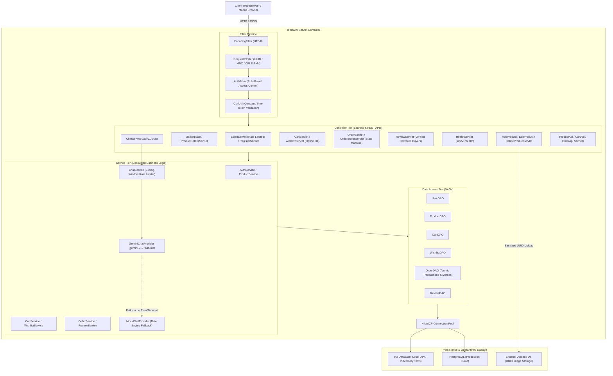

# SameerMart — Multi-Vendor E-Commerce Platform

[](#-automated-testing-suite)
[](https://openjdk.org/)
[-blue.svg)](https://tomcat.apache.org/)
[](https://junit.org/junit5/)
[](#-static-code-analysis--quality-assurance)
[](https://www.postgresql.org/)
[](https://ai.google.dev/)
[](docs/FINAL_REPORT.md)

> **SameerMart** is an enterprise-grade, multi-vendor electronic commerce platform engineered with Java 17, Servlets, JSP, HikariCP connection pooling, JUnit 5 Jupiter, and Google Gemini AI assistance. Developed for the Anna University R2025 Semester 3 Capstone Examination (October 10, 2026).

---

## 🌐 Live Deployment & Demonstrations

- **Live Production URL**: [https://sameermart.onrender.com](https://sameermart.onrender.com) *(Render Cloud)*
- **Health Check Probe**: `GET /api/v1/health` &rarr; `{"success": true, "data": {"status": "UP", ...}}`
- **Chatbot API**: `POST /api/v1/chat` *(asynchronous Gemini / Mock fallback with rate limiting)*
- **Products REST API**: `GET /api/v1/products` *(supports `?category=`, `?search=`, `?id=`)*
- **Cart REST API**: `GET /api/v1/cart` *(authenticated buyer envelope)*
- **Orders REST API**: `GET /api/v1/orders` *(role-aware buyer/seller/admin)*
- **Buyer Wishlist**: `GET /buyer/wishlist` *(Option O1 — persist, manage, and move items to cart)*
- **Seller Sales Dashboard**: `GET /seller/dashboard.jsp` *(Option O3 — Chart.js doughnut & bar charts)*

---

## 🏛️ System Architecture



---

## 💻 Technology Stack

| Component | Technology | Version | Purpose |
| :--- | :--- | :--- | :--- |
| **Language** | Java (OpenJDK) | `17 LTS` | Core platform language |
| **Web Framework** | Java Servlets & JSP | `javax.servlet:4.0` | MVC Controller and Presentation layers |
| **Servlet Container** | Apache Tomcat | `9.0.x` | HTTP server and Servlet environment |
| **Build & Dependencies** | Apache Maven | `3.9.x` | Build automation, packaging, and testing |
| **Connection Pooling** | HikariCP | `5.1.0` | High-throughput JDBC connection pool |
| **Relational Database** | H2 Database / PostgreSQL | `2.2.224` / `42.7.4` | Local in-memory testing & cloud persistence |
| **Password Hashing** | jBCrypt | `0.4.3` | Salted SHA-512 / Blowfish 12-round hashing |
| **JSON Serialization** | Google Gson | `2.11.0` | Standardized API envelope and JSON parsing |
| **Logging & MDC** | SLF4J & Logback Classic | `2.0.16` / `1.5.12` | Structured logging with request tracing |
| **AI Assistant** | Google Gemini API | `Flash-Lite 3.1` | Asynchronous generative support chatbot |
| **Data Visualization** | Chart.js | `4.4.1` | Interactive doughnut & bar sales charts |
| **Testing Engine** | JUnit 5 Jupiter & Mockito | `5.10.2` / `5.12.0` | 244 unit, integration, and mocking tests |
| **Static Analysis** | Checkstyle & SpotBugs | `3.4.0` / `4.8.6.4` | Code style enforcement & bytecode bug audit |

---

## 🌟 Distinction Features (Tier 3)

### Option O1: Buyer Wishlist
- Allows buyers to bookmark products with one click.
- Seamlessly view stock availability, remove items, or move them directly to the shopping cart.
- Backed by `wishlist` relational schema (`user_id`, `product_id`), `WishlistDAO`, `WishlistService`, `WishlistServlet`, and 22 dedicated automated tests.

### Option O3: Seller Sales Intelligence Dashboard
- Visualizes real-time seller analytics powered by **Chart.js**:
  - **KPI Cards**: Total Revenue, Total Orders, Active Products, and Units Sold.
  - **Fulfillment Doughnut Chart**: Live distribution across `PENDING`, `CONFIRMED`, `SHIPPED`, and `DELIVERED`.
  - **Leaderboard Bar Chart**: Top-selling products ranked by units sold and revenue.
  - **Category Sales Breakdown**: Revenue grouped by product category.

---

## 🔒 Security Architecture & Penetration Defense (T3.3)

| Attack Vector | Defense Implementation | Automated Test Proof |
| :--- | :--- | :--- |
| **SQL Injection (SQLi)** | 100% `PreparedStatement` with typed placeholders; zero string concatenation | `SecurityTest.testSqlInjectionPayloadsFailInUserLookup` |
| **Cross-Site Scripting (XSS)** | Central `HtmlUtil.escape()` on all user data rendered in JSPs | `SecurityTest.testHtmlUtilEscapesXssPayloads` |
| **CSRF Attacks** | Cryptographic 32-byte `SecureRandom` tokens with constant-time equality (`MessageDigest.isEqual`) | `SecurityTest.testCsrfConstantTimeComparison` |
| **Brute Force & Credential Stuffing** | Sliding-window lockout (5 failed attempts per IP/email locks for 5 minutes); resets on valid login | `LoginServletTest.testLoginRateLimitingAfterExcessiveFailures` |
| **Session Fixation** | Immediate `request.changeSessionId()` on successful authentication | `LoginServletTest.testPostSuccessfulBuyerLoginSetsSessionAndFixationDefense` |
| **Broken Access Control (BOLA/BFLA)** | Server-side `AuthFilter` role boundaries + DAO seller/buyer ownership scoping | `AuthFilterTest`, `EditProductServletTest`, `OrderServletTest` |
| **Malicious File Uploads** | MIME type validation, file size limit (5 MB), quarantined storage, UUID renaming | `AddProductServletTest`, `EditProductServletTest` |

*Read the full [Security Penetration Self-Audit Report](docs/testing.md#4-security-penetration-self-audit-t33).*

---

## ⚙️ Environment Variables Reference

| Variable Name | Required? | Default Value | Description |
| :--- | :---: | :--- | :--- |
| `DB_URL` | Optional | `jdbc:h2:./data/sameermart` | JDBC connection string (H2 or PostgreSQL) |
| `DB_USER` | Optional | `sa` | Relational database username |
| `DB_PASSWORD` | Optional | *(empty)* | Relational database password |
| `SAMEERMART_UPLOAD_DIR` | Optional | `./data/product-images` | Absolute or relative path to store quarantined product images |
| `GEMINI_API_KEY` | Optional | *(none)* | Google Gemini API key. If omitted, seamlessly falls back to `MockChatProvider` |
| `ADMIN_NAME` | Optional | `Platform Administrator` | Initial seeded administrator account display name |
| `ADMIN_EMAIL` | Optional | `admin@sameermart.com` | Initial seeded administrator email address |
| `ADMIN_PASSWORD` | Optional | `admin123` *(dev only)* | Initial seeded administrator password (auto-hashed with jBCrypt) |

---

## 👥 Demo User Accounts

| Role | Email | Password | Allowed Capabilities |
| :--- | :--- | :--- | :--- |
| **Administrator** | `admin@sameermart.com` | Configured via `ADMIN_PASSWORD` | View platform GMV, moderate products, inspect all orders |
| **Seller** | `seller@sameermart.com` | `seller123` | Create listings, update inventory, manage customer orders, sales dashboard |
| **Buyer** | `buyer@sameermart.com` | `buyer123` | Browse catalog, wishlist, shopping cart, checkout, leave reviews |

---

## 🚀 Step-by-Step Local Setup

### Prerequisites
- **JDK 17 LTS** (`java -version`)
- **Maven 3.9+** (or Maven wrapper)
- **Git**

### 1. Clone the Repository
```bash
git clone https://github.com/MohamedSameer1507/SameerMart.git
cd SameerMart
```

### 2. Build, Run Tests, and Validate Code Quality
```bash
mvn clean verify
```
*Expected output: `BUILD SUCCESS` with **244 tests passing**, 0 Checkstyle violations, 0 SpotBugs bugs.*

### 3. Deploying to Standalone Tomcat 9
1. Package the WAR:
   ```bash
   mvn clean package
   ```
2. Copy `target/SameerMart.war` into Tomcat `webapps/`.
3. Start Tomcat:
   - Windows: `bin\startup.bat`
   - Linux/macOS: `bin/startup.sh`
4. Access the platform at: `http://localhost:8080/SameerMart`

### 4. Running with Docker Container
A production multi-stage `Dockerfile` is included:
```bash
# Build the container image
docker build -t sameermart .

# Run container on port 8080
docker run -d -p 8080:8080 --name sameermart-app sameermart
```
The application is automatically deployed at root context (`http://localhost:8080/`) with persistent upload volume directory.

---

## 🧪 Automated Testing Suite

SameerMart enforces a zero-regression policy. The suite executes against an isolated in-memory H2 database with complete transaction isolation:

```bash
mvn test
```

### Suite Breakdown (244 Tests across 40 Test Classes):
- **Data Access Tier (44 tests)**: `UserDAOTest`, `ProductDAOTest`, `CartDAOTest`, `OrderDAOTest`, `ReviewDAOTest`, `WishlistDAOTest`, `MockChatProviderTest`.
- **Domain & Rules (5 tests)**: `BusinessRuleTest`.
- **Service Tier (44 tests)**: `AuthServiceTest`, `ProductServiceTest`, `CartServiceTest`, `OrderServiceTest`, `ReviewServiceTest`, `WishlistServiceTest`, `ChatServiceTest`.
- **Security & Filters (16 tests)**: `SecurityTest`, `AuthFilterTest`, `RequestIdFilterTest`, `EncodingFilterTest`.
- **Controllers & APIs (129 tests)**: `LoginServletTest`, `LogoutServletTest`, `RegisterServletTest`, `CartServletTest`, `OrderServletTest`, `OrderStatusServletTest`, `SellerOrderServletTest`, `MarketplaceServletTest`, `ProductDetailsServletTest`, `ProductImageServletTest`, `EditProductServletTest`, `DeleteProductServletTest`, `AdminProductStatusServletTest`, `ReviewServletTest`, `WishlistServletTest`, `HealthServletTest`, `ChatServletTest`, `ProductApiServletTest`, `CartApiServletTest`, `OrderApiServletTest`.
- **End-to-End Integration (6 tests)**: `SameerMartFlowTest`.

See full inventory in [docs/testing.md](docs/testing.md).

---

## 🔍 Static Code Analysis & Quality Assurance

Integrated directly into `mvn clean verify` and GitHub Actions CI:
- **Checkstyle (`checkstyle.xml`)**: Enforces clean imports, variable naming, control braces, and modifier order. **Result: 0 violations**.
- **SpotBugs (`spotbugs-exclude.xml`)**: Scans bytecode for security vulnerabilities, concurrency bugs, and null pointer risks. **Result: 0 bugs, 0 errors**.

---

## 📚 Project Documentation Index

- 📑 [Full Capstone Academic Report](docs/FINAL_REPORT.md)
- 🧪 [Testing & Security Self-Audit Report](docs/testing.md)
- 📊 [Mermaid Diagrams](docs/diagrams/):
  - [D1: Entity-Relationship Schema](docs/diagrams/D1_er_diagram.mermaid)
  - [D2: Use Case Model](docs/diagrams/D2_use_case_diagram.mermaid)
  - [D3: Place Order Sequence](docs/diagrams/D3_place_order_sequence.mermaid)
- 📝 [Changelog](CHANGELOG.md)
- 🔍 [Project Retrospective](RETRO.md)
- 🤝 [Contributing Guidelines](CONTRIBUTING.md)

---

## 📄 License & Attribution

Developed by **Mohamed Sameer** for the **Anna University R2025 Semester 3 Java Capstone Examination**.  
All rights reserved © 2026.
