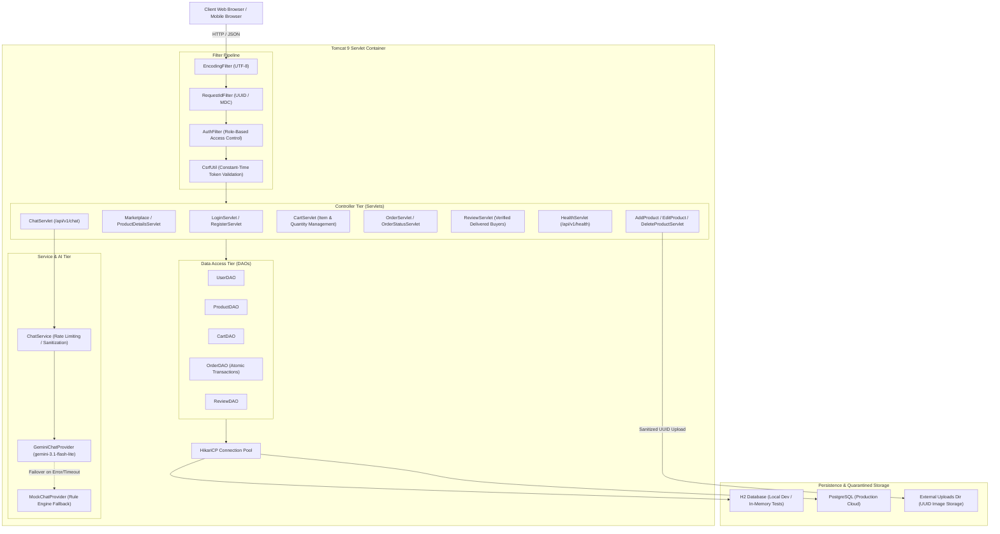

# SameerMart — Multi-Vendor E-Commerce Platform

[](#automated-testing)
[](https://openjdk.org/)
[-blue.svg)](https://tomcat.apache.org/)
[](https://www.postgresql.org/)
[](https://ai.google.dev/)
[](docs/FINAL_REPORT.md)

> **SameerMart** is an enterprise-grade, multi-vendor electronic commerce platform engineered with Java 17, Servlets, JSP, HikariCP connection pooling, and Google Gemini AI assistance. Built for the Anna University R2025 Semester 3 Capstone Project.

---

## 🌐 Live Deployment & Demonstrations

- **Live Production URL**: [https://sameermart.onrender.com](https://sameermart.onrender.com) *(Render / Cloud Deployment)*
- **Health Check Probe**: `GET /api/v1/health` &rarr; `{"success": true, "data": {"status": "UP", ...}}`
- **Chatbot API**: `POST /api/v1/chat`
- **Products REST API**: `GET /api/v1/products` *(supports `?category=`, `?search=`, `?id=`)*
- **Cart REST API**: `GET /api/v1/cart` *(authenticated buyer)*
- **Orders REST API**: `GET /api/v1/orders` *(role-aware buyer/seller/admin)*

---

## 🏛️ System Architecture



---

## 💻 Technology Stack

| Component | Technology | Version | Purpose |
| :--- | :--- | :--- | :--- |
| **Language** | Java (OpenJDK) | `17 LTS` | Core platform language |
| **Web Framework** | Java Servlets & JSP | `javax.servlet:4.0` | MVC Controller and Presentation layers |
| **Servlet Container** | Apache Tomcat | `9.0.x` | HTTP server and Servlet environment |
| **Build & Dependencies** | Apache Maven | `3.9.x` | Build automation, packaging, and testing |
| **Connection Pooling** | HikariCP | `5.1.0` | High-throughput JDBC connection pool |
| **Relational Database** | H2 Database / PostgreSQL | `2.2.224` / `42.7.4` | Local in-memory testing & cloud persistence |
| **Password Hashing** | jBCrypt | `0.4.3` | Salted SHA-512 / Blowfish 12-round hashing |
| **JSON Serialization** | Google Gson | `2.11.0` | Standardized API envelope and JSON parsing |
| **Logging & MDC** | SLF4J & Logback Classic | `2.0.16` / `1.5.12` | Structured logging with request tracing |
| **AI Assistant** | Google Gemini API | `Flash-Lite 3.1` | Asynchronous generative support chatbot |
| **Testing** | JUnit 4 & Mockito | `4.13.2` / `5.12.0` | Unit, integration, and mocking framework |

---

## ⚙️ Environment Variables Reference

The application reads configuration from environment variables, falling back to Java system properties, then safe local defaults:

| Variable Name | Required? | Default Value | Description |
| :--- | :---: | :--- | :--- |
| `DB_URL` | Optional | `jdbc:h2:./data/sameermart` | JDBC connection string (H2 or PostgreSQL) |
| `DB_USER` | Optional | `sa` | Relational database username |
| `DB_PASSWORD` | Optional | *(empty)* | Relational database password |
| `SAMEERMART_UPLOAD_DIR` | Optional | `./data/product-images` | Absolute or relative path to store quarantined product images |
| `GEMINI_API_KEY` | Optional | *(none)* | Google Gemini API key. If omitted, seamlessly falls back to `MockChatProvider` |
| `ADMIN_NAME` | Optional | `Platform Administrator` | Initial seeded administrator account display name |
| `ADMIN_EMAIL` | Optional | `admin@sameermart.com` | Initial seeded administrator email address |
| `ADMIN_PASSWORD` | Optional | `admin123` *(dev only)* | Initial seeded administrator password (auto-hashed with jBCrypt) |

> [!IMPORTANT]
> In production environments (e.g. Render, Railway, AWS), set `DB_URL` to your PostgreSQL connection string and provide a strong `ADMIN_PASSWORD` and `GEMINI_API_KEY`.

---

## 👥 Demo User Accounts

When the application starts for the first time, default accounts can be seeded or registered:

| Role | Email | Password | Allowed Capabilities |
| :--- | :--- | :--- | :--- |
| **Administrator** | `admin@sameermart.com` | Configured via `ADMIN_PASSWORD` | View platform GMV, moderate products, inspect all orders |
| **Seller** | `seller@sameermart.com` | `seller123` | Create listings, update inventory, manage customer orders |
| **Buyer** | `buyer@sameermart.com` | `buyer123` | Browse catalog, shopping cart, checkout, leave reviews |

*(You can also freely register new Buyer or Seller accounts on the `/register.jsp` page).*

---

## 🚀 Step-by-Step Local Setup

### Prerequisites
- **JDK 17 LTS** installed (`java -version`)
- **Maven 3.9+** installed (or Maven wrapper)
- **Git** installed

### 1. Clone the Repository
```bash
git clone https://github.com/MohamedSameer1507/SameerMart.git
cd SameerMart
```

### 2. Build and Execute Automated Tests
On Windows (using Maven or wrapper):
```cmd
mvn clean verify
```
On Linux / macOS:
```bash
mvn clean verify
```
*Expected output: `BUILD SUCCESS` with **153 tests passing**, 0 failures, 0 errors.*

### 3. Running Locally with Tomcat
#### Option A: Deploying WAR to Standalone Tomcat 9
1. Package the WAR artifact:
   ```bash
   mvn clean package
   ```
2. Copy `target/SameerMart.war` into your Tomcat `webapps/` folder.
3. Start Tomcat:
   - Windows: `bin\startup.bat`
   - Linux/macOS: `bin/startup.sh`
4. Access the platform at: `http://localhost:8080/SameerMart`

#### Option B: Running with Maven Cargo / Embedded Plugin
```bash
mvn tomcat7:run -Dmaven.tomcat.port=8080
```

---

## 🧪 Automated Testing Suite

SameerMart enforces a zero-regression policy. The suite executes against an isolated in-memory H2 database with complete transaction isolation:

```bash
mvn test
```

### Coverage Highlights:
- **`OrderServletTest` & `OrderDAOTest`**: Verifies atomic transaction commit and rollback, stock sufficiency validation, and cart clearing.
- **`OrderStatusServletTest`**: Verifies valid transitions (`CONFIRMED` &rarr; `SHIPPED` &rarr; `DELIVERED`), seller item authorization, and HTTP 409 Conflict rejection.
- **`ReviewDAOTest`**: Verifies that buyers can only review products from orders in `DELIVERED` status, duplicate review rejection, and 1–5 star constraints.
- **`ChatServletTest` & `ChatServiceTest`**: Verifies rate limiting (10 req/min), CSRF protection, 500-char length sanitization, and mock failover.
- **`SecurityTest` & `AuthFilterTest`**: Verifies session hijacking defenses, role authorization guards, and per-session CSRF token constant-time comparison.

---

## 📚 Project Documentation Index

- 📑 [Full Capstone Academic Report](docs/FINAL_REPORT.md)
- 📊 [Mermaid Diagrams](docs/diagrams/):
  - [D1: Entity-Relationship Schema](docs/diagrams/D1_er_diagram.mermaid)
  - [D2: Use Case Model](docs/diagrams/D2_use_case_diagram.mermaid)
  - [D3: Place Order Sequence](docs/diagrams/D3_place_order_sequence.mermaid)
- 📝 [Changelog](CHANGELOG.md)
- 🔍 [Project Retrospective](RETRO.md)
- 🤝 [Contributing Guidelines](CONTRIBUTING.md)

---

## 📄 License & Attribution

Developed by **Mohamed Sameer** for the **Anna University R2025 Semester 3 Java Capstone Examination**.  
All rights reserved © 2026.
